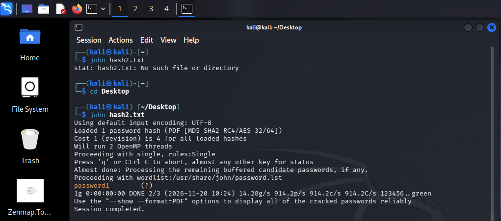
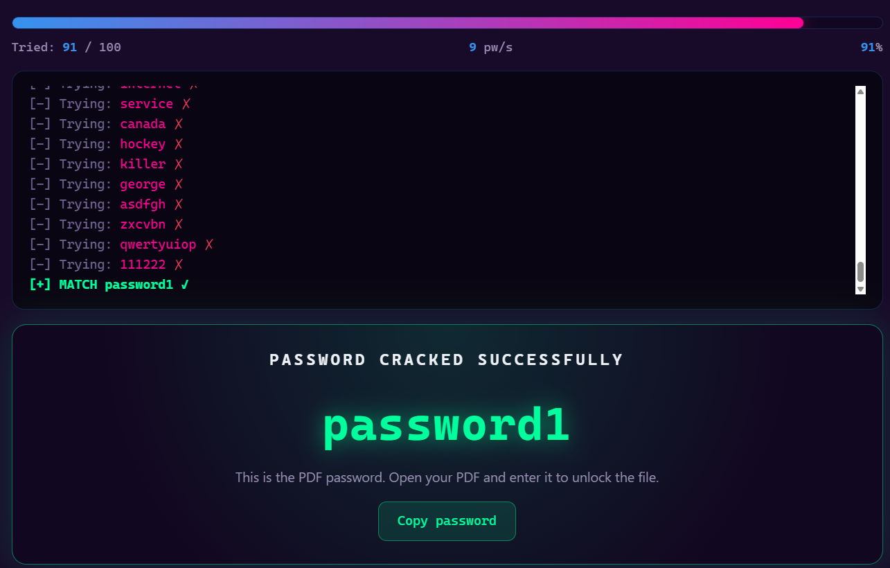
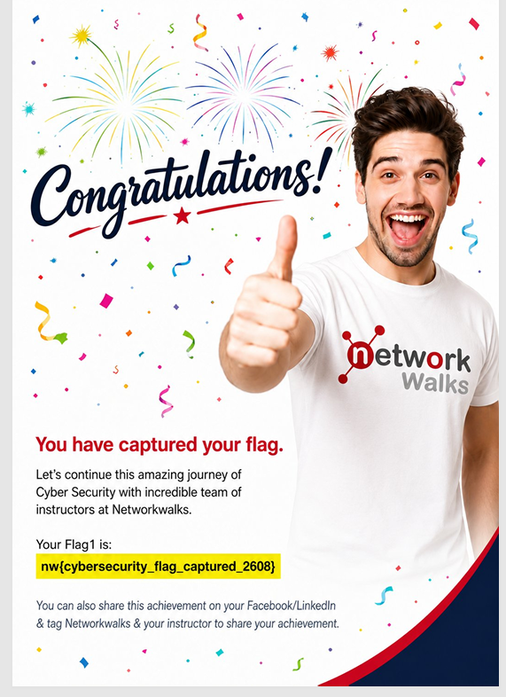

# 🔐 Week 3: PDF Password Cracking Lab

**Networkwalks Cybersecurity & Ethical Hacking Internship — Project Modules 1 & 2**

## 📌 Overview
This repository documents the completion of two ethical hacking labs focused on recovering a weak password from an encrypted PDF file (`My Locked PDF2.pdf`). 

The goal of this lab is to demonstrate how cryptographic hashes are extracted from password-protected documents and recovered using dictionary attacks in both a **Kali Linux CLI environment** and **browser-based security tools**.

---

## 🛠️ Tools Used
* **Module 1 (Kali Linux CLI):** `pdf2john` & `John the Ripper (JTR)` with `rockyou.txt`
* **Module 2 (Web Tools):** [Networkwalks Hash Calculator](https://networkwalks.com) & [Networkwalks Password Cracker](https://networkwalks.com)

---

## 🚀 Lab Execution & Proof of Work

### Module 1: Password Cracking with John the Ripper (Kali Linux)
1. **Extract the PDF Hash:**
   ```bash
   pdf2john "My Locked PDF2.pdf" > hash2.txt
   ```
2. **Run Dictionary Attack with `rockyou.txt`:**
   ```bash
   john --wordlist=/usr/share/wordlists/rockyou.txt hash2.txt
   ```
3. **Display Recovered Password:**
   ```bash
   john --show hash2.txt
   # Output: My Locked PDF2.pdf:password1
   ```

#### 📸 JTR Terminal Result


---

### Module 2: Password Cracking with Networkwalks Web Tools
1. **Hash Extraction:** Uploaded `My Locked PDF1.pdf` to the **Networkwalks Hash Calculator** to extract the `$pdf$` hash locally in the browser.
2. **Dictionary Attack:** Pasted the extracted hash into the **Networkwalks Password Cracker** and executed the attack using the built-in wordlist.
3. **Result:** Successfully matched the hash to `password1`.

#### 📸 Networkwalks Web Cracker Result


---

### 🏆 Final Verification (Flag Captured)
Used the recovered password (`password1`) to unlock `My Locked PDF2.pdf` and verify document access:



---

## 🧠 Key Takeaways: Encryption vs. Hashing
* **Encryption** is a *two-way* function used to protect data confidentiality; encrypted data can be decrypted back to plaintext with the proper key.
* **Hashing** is a *one-way* cryptographic function that converts plaintext into a fixed-length digest. Because hashes cannot be reversed mathematically, password crackers hash candidate words from a wordlist and compare the outputs until a match is found.

---

## ⚠️ Disclaimer
*This project was completed strictly for educational purposes in an authorized lab environment as part of the Networkwalks Cybersecurity Internship.*
